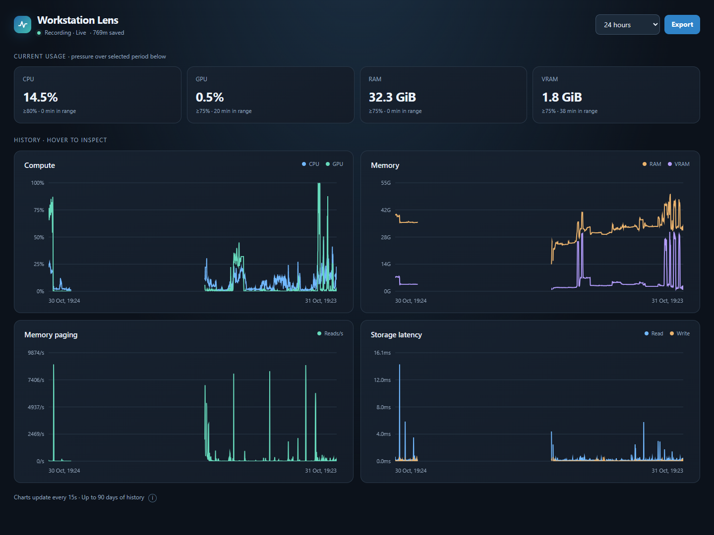
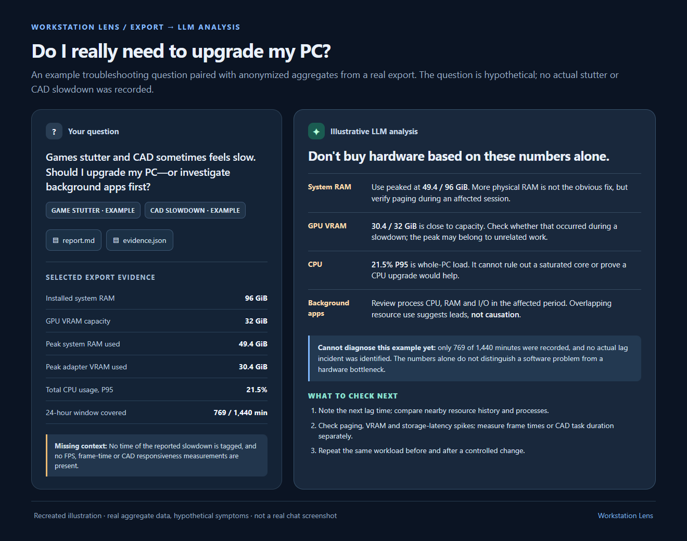
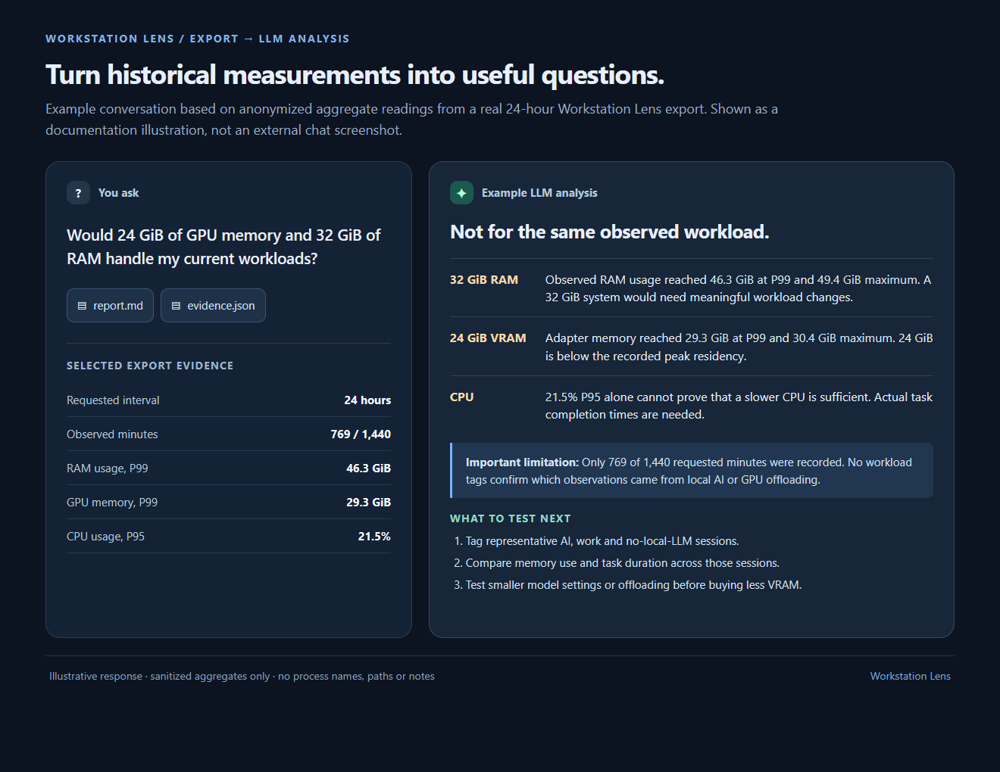

# Workstation Lens

**Game stuttering? CAD slowing down? Was it a busy background app, or is your PC running out of resources?**

By the time you open Task Manager, the spike may already be gone. Workstation Lens keeps a local history of Windows resource use, so you can look back at a slow period instead of guessing whether to close a background program, investigate Windows, or buy new hardware.

It records CPU, GPU, RAM, VRAM, memory paging and storage-latency trends, plus application and process activity. Explore the history in a browser dashboard, or export the evidence for ChatGPT, Claude or another LLM to help investigate. **No account, subscription, API key or automatic cloud upload.**

**[Download Workstation Lens v1.0.0 for Windows](https://github.com/clemarstudio/WorkstationLens/releases/tag/v1.0.0)** | [Direct Windows x64 installer](https://github.com/clemarstudio/WorkstationLens/releases/download/v1.0.0/Clemar.WorkstationLens-win-Setup.exe)



*Local dashboard showing current CPU/GPU/RAM/VRAM usage and historical resource pressure.*

## What can I investigate?

- **Unexpected background activity:** Did a game, CAD session or other demanding task overlap with a background process consuming CPU, memory or I/O?
- **Possible hardware pressure:** Were CPU or GPU engines busy, was one CPU core heavily loaded, or did RAM/VRAM use, paging or storage latency rise?
- **Repeatable slowdowns:** Do similar spikes appear when the same task slows down again, or only when certain background apps are running?
- **Before spending money:** Is there a software/workload interaction worth testing before deciding that more RAM, a faster CPU or a new GPU is the answer?

### A practical troubleshooting workflow

1. Let Workstation Lens record while you work or play; you can close the dashboard and leave the collector running.
2. When the PC feels slow, note roughly **when** it happened and what application you were using.
3. Reopen the dashboard, select that period (or a custom date/time range), and inspect the trends.
4. Export the selected range to review application and per-process evidence, or ask an LLM to compare it with the machine-wide measurements.
5. Test the most plausible explanation under similar conditions before disabling software, changing settings or upgrading hardware.

**Evidence, not an automatic diagnosis.** A process using resources is not proof that it caused lag or is malicious. Sampling is every 15 seconds, with older measurements summarized by minute; brief frame-time spikes may be missed. Workstation Lens does **not** directly measure FPS, frame times, temperatures, driver faults or CAD application response time. Its purpose is to narrow the investigation, not identify every possible cause.

## How it works

The collector runs in the Windows notification area, even when the dashboard is closed. There is no permanent console window.

- Samples the machine every **15 seconds**.
- Shows live CPU, GPU, RAM and VRAM, with interactive compute, memory, paging and storage-latency charts.
- Stores **one-minute machine history**, **15-minute application summaries** and short-term **per-process (PID) details** in local SQLite.
- Keeps system/application trends for up to **90 days** and individual PID records for **14 days**.
- Lets you choose a preset period or a custom date/time range. **Export** downloads a ZIP for that exact selection.

### Investigate a slowdown with an LLM

Choose the time window covering the slowdown, then click **Export**. The ZIP includes:

| File | What it's for |
|---|---|
| `report.md` | Readable resource summary, percentiles, application activity and measurement caveats |
| `evidence.json` | Structured measurements for deeper comparisons and analysis |
| `workstation-lens-records.csv` | Machine, application and process history (filter by `record_type`) |
| `README.txt` | Short guide to the files, columns and units |

Attach `report.md` and `evidence.json` to the LLM of your choice (optionally the CSV), and ask something like:

> My game stuttered / CAD became slow around [date and time]. Using only the recorded evidence in this export, did any background applications consume unusual CPU, memory or I/O? Was there sustained CPU/GPU pressure, a busy core, RAM/VRAM pressure, paging or high storage latency? Separate observations from possible explanations, flag missing measurements, and suggest controlled checks before I change software or buy hardware. Do not assume a process is malicious just because it used resources.

**Illustrative example: Is upgrading actually necessary?** This example uses anonymized aggregate readings from a real Workstation Lens export, but the game-stutter/CAD-slowdown question is hypothetical. With no specific lag event identified, the analysis suggests what to check before buying hardware rather than pretending to know the cause.



*Recreated for documentation; not a screenshot of a third-party chat. The measurements describe a real workstation, but do not establish that a game or CAD slowdown occurred during the observed period.*

Use the actual time zone when describing when the slowdown occurred; the export reports timestamps in UTC. Application summaries are aggregated over 15-minute periods, while individual process details are stored per minute, so not every 15-second spike can be attributed to a particular process.

**Your data stays local until you decide to share it.** Workstation Lens does not call an LLM itself. Check application names and any workload notes in the export before uploading it to an external service. Empty CSV fields mean unavailable or not applicable, **not zero**.

## Try it

Download [Workstation Lens v1.0.0](https://github.com/clemarstudio/WorkstationLens/releases/tag/v1.0.0), or get the [Windows x64 installer directly](https://github.com/clemarstudio/WorkstationLens/releases/download/v1.0.0/Clemar.WorkstationLens-win-Setup.exe). The installer bundles the .NET 10 runtime; you do not need the .NET SDK to run it. A portable ZIP and SHA-256 checksums are also available on the release page.

Requires **Windows 11 x64**. The installer and main application executable are signed and timestamped; Windows displays **Siu Bong Pang** as the publisher. Other bundled components retain their existing signature state. The final signed installer has passed signature and package checks, but isolated clean-install and signed-upgrade acceptance testing is still pending; see the release notes.

To **build and run from source**, install the **.NET 10 SDK**, download this repository (using **Code → Download ZIP** on GitHub), extract it, then open PowerShell in the extracted folder:

```powershell
powershell.exe -NoProfile -ExecutionPolicy Bypass -File .\Start-Lens.ps1
```

The dashboard opens at [http://127.0.0.1:18765](http://127.0.0.1:18765). Once started, you can close the browser and leave the collector running. To stop it, use `Stop-Lens.cmd`. Both `.cmd` files are shortcuts for the matching PowerShell scripts. For optional launch at Windows sign-in, use `scripts/Enable-Autostart.ps1` or `scripts/Disable-Autostart.ps1`; these are not needed for normal use.

## How lightweight is it?

I checked the collector on **31 October 2026, around 19:00 UTC**, on a Windows 11 workstation with 32 logical processors and roughly 500 running processes. These are short spot measurements, **not a 24-hour CPU or RAM benchmark**:

| Measurement | Observed | Measurement window |
|---|---|---|
| RAM working set | About **145–148 MiB** | Spot readings during approximately one minute |
| Private memory | About **70–73 MiB** | Same short observation period |
| CPU | About **0.01% of total CPU** | One **20-second** interval; occasional short activity |
| Collection time | Roughly **19–51 ms** | Several individual collection passes, scheduled every 15 seconds |
| Local history database | Around **108 MiB**, plus a **5 MiB** SQLite write-ahead log | Point-in-time size after about **1,990 recorded machine-minutes (33 hours)** accumulated since 29 October 2026 |

The database had accumulated measurements over roughly **55 hours of wall-clock time**, with gaps where no data was recorded; it was **not a 90-day database-size test**. These figures come from *one machine*, not guaranteed limits or a sustained-load benchmark. CPU, memory and database size depend on the system, process count and retention history.


## Another use: planning a hardware change

After you've checked for obvious background-workload problems, the same measurements can help you evaluate a proposed RAM/VRAM change. The example below uses anonymized aggregates from an actual workstation export to illustrate how an LLM might discuss trade-offs; it is **not** a genuine third-party chat screenshot or a recommendation to downgrade.



*Illustrative analysis: the 49.4 GiB RAM peak was measured on the original 96 GiB machine, not on the proposed 32 GiB configuration. Memory in use is not the same as a minimum hardware requirement; confirm proposed changes with actual workload tests.*

## Privacy and limitations
Everything is recorded in `%LOCALAPPDATA%\WorkstationLens\measurements.db`. The dashboard listens on localhost and doesn't need a cloud account. **Nothing is automatically uploaded to an LLM.** You decide whether and where to share an export.

Exports can include application names and any workload notes you enter. Check the files before attaching them to an online service. The collector doesn't capture document names, command lines, browser URLs or window titles.

GPU percentages reflect Windows WDDM engines, not CUDA compute occupancy. Per-process GPU memory attribution is not the same as total physical VRAM. Short spikes between samples may be missed. These limitations are noted in the exported report so an LLM has a better chance of interpreting the evidence correctly.

## For contributors

`WorkstationLens.App/` contains the collector and local dashboard; `UpdateKit/` contains the update integration. `tests/Smoke-Test.ps1` checks the running API and exports, while `UpdateKit.Tests/` tests the updater without installing it. `scripts/Pack-Windows.ps1` is for packaging signed releases. These developer tools are **not required to run the app**.

## License

MIT — see [LICENSE](LICENSE). Built by Clemar Studio.
